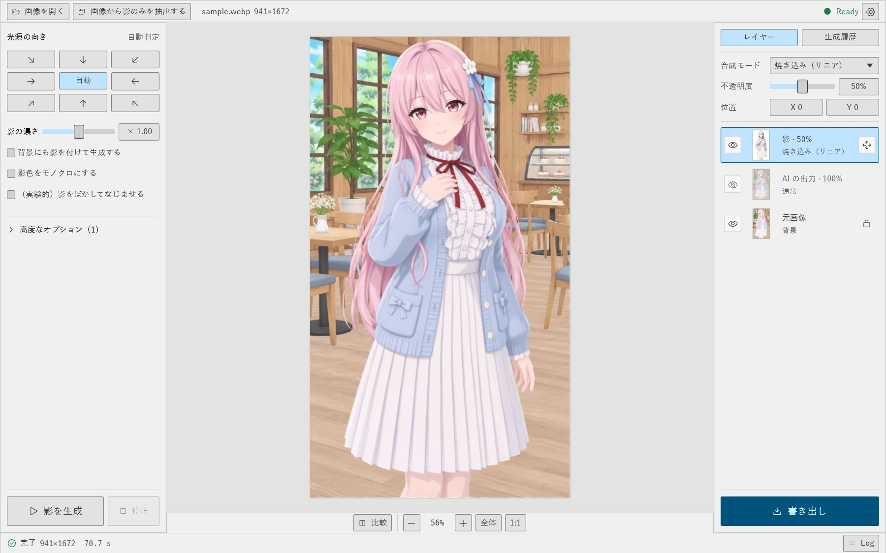
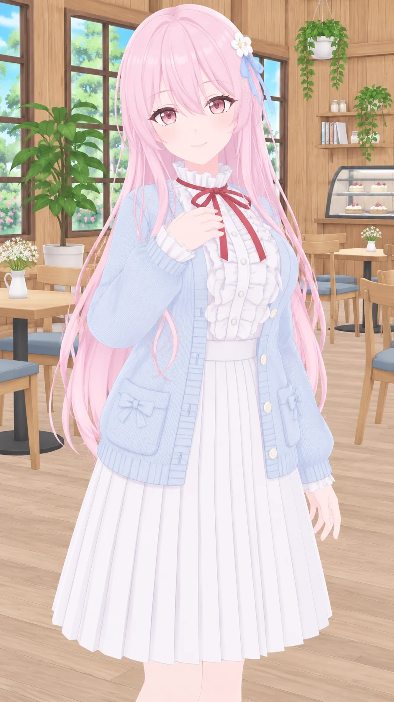
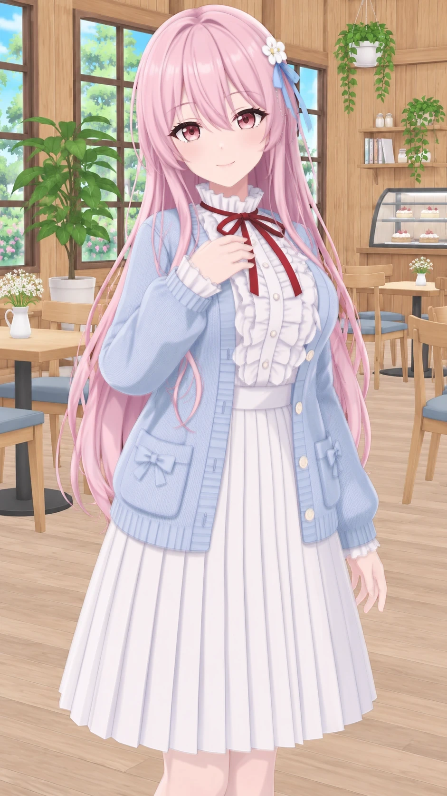
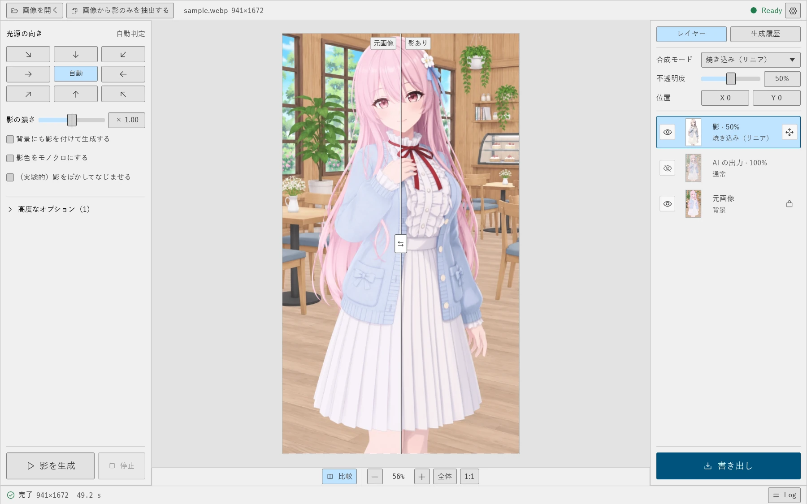

# 後付け影MOD

画像に AI で影を付け、影のみを別レイヤーとして取り出せるレタッチ補助ツールです。
処理はすべてローカルで行います。

「後付けって ATODUKE じゃないの？」うるせえ。ヘボン式だと ATOZUKE なんだよ。

なお、このアプリは Vibe Coded です。

## プレビュー



| 元画像 | 影レイヤー | 合成結果 |
| --- | --- | --- |
|  |  |  |

比較表示で、元画像と影を付けた画像を見比べられます。



元画像は画像生成 AI で作成したサンプルです。設定は既定値のままです（背景の影なし、焼き込み（リニア）、不透明度 50%）。

## 開発の経緯

影のない人物の画像、例えば人型の 3D モデルの写真などに影を付けるために開発しました。影を手で描くのは手間がかかるため、AI に生成させて、編集できるレイヤーとして取り出せるようにしました。

## できること

- 任意の画像に AI で影を付ける
- 影だけを別レイヤーとして取り出す。輪郭は元画像の解像度に合わせます
- 濃さ、合成モード、不透明度、影の位置を生成後に変更する
- PNG / JPEG / WebP で書き出す

## 利用の流れ

1. 影のない 3D モデルの写真などを用意する
2. 画像をこのアプリで開き、影を生成する
3. 用途に合わせて書き出す
   - このアプリの調整だけで足りる場合は、合成結果をそのまま使う
   - 細かく編集する場合は、影レイヤーを書き出し、CLIP STUDIO PAINT や Photoshop で元画像に重ねる

## メリットとデメリット

メリット:

- 影を編集できるレイヤーとして 1 回で作成し、後から自由に調整できる
- 色付きの影も、編集できるレイヤーとして生成できる
- 完全ローカルで影のレイヤーを作成できる

デメリット:

- GPU のリソースを非常に多く使う
- モデルだけで 17.7 GB の空き容量が必要

## 必要なもの

- NVIDIA GPU（VRAM 12GB で動作確認）
- [ComfyUI](https://github.com/comfyanonymous/ComfyUI/releases) 0.40 以降
- 次のモデル 4 ファイル（合計 17.7 GB）

モデルは `models` の中の各ディレクトリに入れてください。パスの設定は不要で、入れると自動で認識します。
自動ダウンロードはしません。名前、サイズ、SHA-256 が公式と一致するファイルだけを読み込みます。

| 置き場所 | ファイル | サイズ | 配布元 |
| --- | --- | --- | --- |
| `diffusion_models` | `qwen_image_2.1_int8_convrot.safetensors` | 7.26 GB | [Comfy-Org/Qwen-Image-2.1](https://huggingface.co/Comfy-Org/Qwen-Image-2.1/tree/main/diffusion_models) |
| `text_encoders` | `qwen3vl_8b_int8_convrot.safetensors` | 9.35 GB | [Comfy-Org/Qwen-Image-2.1](https://huggingface.co/Comfy-Org/Qwen-Image-2.1/tree/main/text_encoders) |
| `vae` | `qwen_image_2.1_vae_bf16.safetensors` | 0.68 GB | [Comfy-Org/Qwen-Image-2.1](https://huggingface.co/Comfy-Org/Qwen-Image-2.1/tree/main/vae) |
| `background_removal` | `birefnet.safetensors` | 0.44 GB | [Comfy-Org/BiRefNet](https://huggingface.co/Comfy-Org/BiRefNet/tree/main/background_removal) |

## 使い方

1. `AtozukeKageMOD.exe` を起動し、画面の手順で ComfyUI とモデルを設定
2. 画像を開く
3. 光源の向きを選び、「影を生成」を押す
4. 書き出す

合成結果を書き出す場合は、書き出す前に次の項目を調整できます。

- 左のパネル: 影の濃さ、背景の影、影色のモノクロ、影のぼかし（影レイヤーの書き出しにも反映します）
- 右のパネルの「影」レイヤー: 合成モード、不透明度、位置
- レイヤーの目のアイコン: 表示中のレイヤーだけが合成結果に入ります

処理時間は RTX 4070 Ti 12GB で 1 枚 30 秒〜1 分、4K で約 100 秒です。起動後の初回は、モデルの読み込みで数分長くかかります。

| キー | 動作 |
| --- | --- |
| Ctrl+O | 開く |
| Ctrl+S | 書き出し |
| Ctrl+0 / Ctrl+1 | 全体 / 等倍 |
| Ctrl++ / Ctrl+- | 拡大 / 縮小 |
| C（押している間） | 元画像を表示 |
| V | 影の移動のオン／オフ |
| 矢印 / Shift+矢印 | 影を 1 / 10 ピクセル移動（移動がオンのとき） |

## 仕様

- 濃さ、背景、モノクロ、ぼかしの変更は AI を再実行せずに反映します。光源の向きと追加の指示を変えたら再生成が必要です
- 影レイヤーは、レイヤー一覧の移動ボタンをオンにしてドラッグすると移動できます。位置は書き出しにも反映します
- 透過画像の透明部分は保持します。JPEG は白地に合成します
- ComfyUI は `127.0.0.1` の専用ポートで起動し、アプリと一緒に終了します。カスタムノードと、外部 API を使うノードは読み込みません
- 起動時に GitHub のリリース情報を確認し、新しいバージョンがあれば画面上部に表示します。画像は送信しません。確認は設定でオフにできます
- アップデートで入れ替えるのは exe、README、LICENSE だけです。`models` と `data` は変更しません
- 設定、ログ、作業ファイルは exe と同じ場所の `data` に保存します。書き込めない場合は `%LOCALAPPDATA%\AtozukeKageMOD` を使います

## ライセンス

本体は [MIT](LICENSE) です。ComfyUI とモデルは同梱していません。各ライセンスに従って利用してください。
Qwen-Image 2.1 には利用条件があります。商用利用の前に確認してください。

## ビルド

```
cargo build --release
cargo test --release --lib --tests
```

---

Retouching aid that adds AI shading to an image and extracts only the shadows as a separate layer. All processing is local. Requires ComfyUI 0.40+ and the four model files above. Models are never downloaded automatically.
